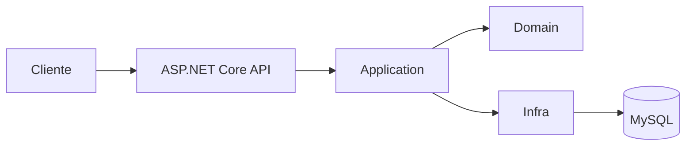
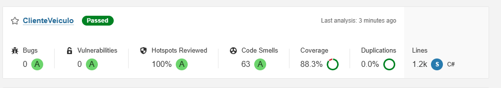

# Serviço de Cliente e Veículo

Microsserviço da plataforma Tech Challenge responsável pelas operações de clientes e veículos.

## Visão geral

A API disponibiliza operações de cadastro e consulta relacionadas a clientes e veículos. Os endpoints disponíveis e seus contratos podem ser consultados no Swagger.

## Arquitetura

O serviço segue uma arquitetura em camadas: a API recebe as requisições HTTP, a camada Application coordena os casos de uso, Domain concentra as regras de negócio e Infra implementa persistência e integrações. O projeto IOC registra as dependências.



| Projeto | Responsabilidade |
|---|---|
| `src/ClienteVeiculoService` | API HTTP, controllers, middleware e configuração da aplicação |
| `src/Application` | Casos de uso e orquestração |
| `src/Domain` | Entidades, agregados, objetos de valor e regras de negócio |
| `src/Infra` | Persistência e integrações |
| `src/IOC` | Registro e composição das dependências |
| `src/Tests` | Testes automatizados de Application e Domain |

## Tecnologias

- .NET e ASP.NET Core
- MySQL
- Docker e Docker Compose
- GitHub Actions e SonarQube

## Executar localmente

Pré-requisitos: SDK do .NET e Docker com Docker Compose.

```bash
dotnet restore src/ClienteVeiculoServiceSolution.slnx
dotnet run --project src/ClienteVeiculoService/ClienteVeiculoService.csproj
```

Para executar com Docker Compose:

```bash
docker compose -f src/docker-compose.yml up --build
```

## API e documentação

- Swagger UI: `http://localhost:5021/swagger`
- OpenAPI JSON: `http://localhost:5021/openapi/v1.json`
- Verificações de saúde: `/health/live`
- Controllers: `src/ClienteVeiculoService/Controllers`
- Exemplos de requisição: [ClienteVeiculoService.http](./src/ClienteVeiculoService/ClienteVeiculoService.http)

## Testes e cobertura

Para executar a suíte de testes:

```bash
dotnet test src/ClienteVeiculoServiceSolution.slnx --configuration Release
```

O pipeline exige cobertura mínima de 80% de linhas para os testes de Domain e Application.

### Evidência de cobertura

Adicione o print da execução dos testes abaixo. Salve a imagem em `docs/images/cobertura-testes.png` ou ajuste o caminho para o arquivo que você adicionar ao repositório.



## Docker e Kubernetes

- Dockerfile: [src/Dockerfile](./src/Dockerfile)
- Docker Compose: [src/docker-compose.yml](./src/docker-compose.yml)
- Manifestos Kubernetes: não há manifestos versionados neste repositório. O workflow de deploy reinicia o Deployment `auto-repara-deployment` no cluster configurado.

## CI/CD

- [CI de branches feature](./.github/workflows/ci-cd-local.yml): build, testes, análise SonarQube e criação de PR para `main`.
- [Deploy da branch main](./.github/workflows/deploy-main-dockerhub.yml): build e publicação da imagem `maquese/clienteveiculo` no Docker Hub e atualização do Deployment no Kubernetes.

Configure os secrets e variáveis necessários no GitHub Actions, incluindo credenciais do SonarQube e do Docker Hub.
